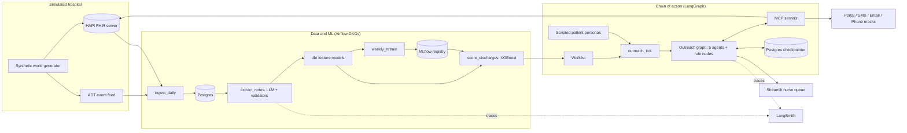

# Design: Readmission Risk and Outreach Agents

Small-scale, end-to-end simulation of a hospital medicine readmission program.
Synthetic data only. Everything free. Runs on a laptop with Docker.
Fictional hospital: Orchard Valley Medical Center. No real branding.

## 1. Goal

- Predict 30-day unplanned readmission risk at discharge (XGBoost)
- Flagged patients enter a multi-agent chain of action
- Outreach only through channels the patient opted into, in their preferred mode and language
- Back-and-forth with the patient until a follow-up or telehealth visit is booked
- Every step observable and evaluated: pipelines, model, agents, guardrails, judge, outcomes

## 2. Decisions

| Decision | Choice |
|---|---|
| Prediction model | XGBoost |
| LLM | Gemini only (free tier), via LiteLLM with fallback between Gemini models |
| Agent framework | LangGraph |
| Orchestration | Airflow DAGs |
| Tracing, evals | LangSmith |
| Primary channel | Patient portal for patients with an account |
| Languages | English, Spanish |
| Holdout | 20% of flagged patients get standard care only |
| Caregivers / proxies | Out of scope for v1 |
| Human labels for judge validation | Simulated (labels known by construction, see 15.3) |
| Patient replies | Scripted personas, no LLM simulator |

## 3. Constraints

| Constraint | How it's met |
|---|---|
| Free | Open-source tools, free tiers, local Docker |
| No real PHI | Synthetic patients, synthetic notes |
| Small but enough to evaluate | ~1,500 patients, ~3,000 stays, ~150-200 flagged patients through outreach over a simulated 90 days |
| Realistic | FHIR data, ADT events, messy notes, durable agent state, human in the loop |
| Reproducible | Fixed seeds, cached LLM responses |

## 4. Architecture



## 5. Tools: real-world vs this project

| Layer | Real-world | This project (free) |
|---|---|---|
| EHR data | Epic, FHIR APIs, HL7 ADT | HAPI FHIR server + simulated ADT events |
| Data platform | Databricks / Snowflake + dbt | Postgres + dbt Core |
| Orchestration | Managed Airflow | Airflow in Docker |
| ML platform | Databricks / Azure ML / SageMaker | MLflow |
| LLM | Azure OpenAI / Bedrock / Vertex under BAA | Gemini free tier via LiteLLM (synthetic data only) |
| Agents | LangGraph | LangGraph |
| Tools for agents | Internal APIs | MCP servers (FastMCP) |
| Tracing, evals, prompt versions | LangSmith enterprise / self-hosted | LangSmith free Developer plan |
| Patient portal | Epic MyChart | Mock portal inbox (Streamlit page) |
| SMS | Twilio | Twilio-shaped mock |
| Email | SendGrid | Mailpit |
| Phone | Nurse calls, IVR | Scripted call outcomes |
| Scheduling | Epic Cadence via FHIR | FHIR Slot / Appointment on HAPI |
| Nurse work queue | Epic In Basket | Streamlit |
| Data quality | dbt tests, Great Expectations | dbt tests, Pandera |
| Drift | Datadog, Arize, Evidently | Evidently |
| Serving | Kubernetes | FastAPI in Docker |
| CI/CD | GitHub Actions | GitHub Actions |

Production swap = point LiteLLM at a BAA-covered provider. No other code change.

## 6. Synthetic world

### 6.1 Patients
- Demographics, payer, language (English / Spanish), area deprivation decile
- Contact: portal account, email, mobile, telehealth capability
- Consent: portal, SMS, email, phone, telehealth opt-ins; preferred channel; contact window
- Hidden: frailty, social circumstances, outreach persona

### 6.2 Stays
- ~30 clinical factors
- Structured at discharge: demographics, dates, LOS, disposition, labs, vitals, prior utilization
- Notes only: diagnoses and comorbidities, EF, med changes, high-risk meds, follow-up booked, social barriers
- Reason: billing ICD-10 codes are finalized days after discharge, not available at prediction time

### 6.3 Notes (messy on purpose)
- Types: H&P, progress, case management, nursing discharge, discharge summary, post-discharge call
- Abbreviations (HFrEF, DM2, CKD3b, SOB, DOE, s/p, p/w), ambiguous ones (MS, PE)
- ICD-10 codes inline, sometimes missing or partial
- Negations, rule-outs, historical vs current, family history
- Copy-forward, typos, conflicting notes
- Hybrid generation: templates create the facts, Gemini rewrites a subset in clinician voice, fact check confirms nothing dropped or invented

### 6.4 Hidden truth
- True readmission probability per stay
- True facts per note
- Persona per patient
- Stored separately, never a model or agent input

### 6.5 Outreach affects outcomes
- Follow-up completed within 7 days lowers the patient's true risk
- Holdout vs outreach comparison measures real impact

### 6.6 FHIR mapping
| Concept | FHIR resource |
|---|---|
| Patient, contact, language | Patient |
| Consent per channel | Consent |
| Stay | Encounter |
| Diagnoses (when coded) | Condition |
| Labs, vitals | Observation |
| Discharge meds | MedicationRequest |
| Notes | DocumentReference |
| Open visit times | Slot, Schedule |
| Booked visit | Appointment |
| Messages sent / received | Communication |

### 6.7 ADT feed
- Admit, discharge, transfer events
- Discharge event starts the scoring clock
- Admit event for a patient in outreach = readmission, stops outreach

## 7. Labels, splits, prediction time

- Label: unplanned admission within 30 days of discharge, same patient. Planned admissions don't count.
- Label before exclusions
- Exclude: in-hospital death, hospice. Keep AMA.
- Label maturity: no label until 30 days after discharge
- Split by time: train, test (tagged new vs repeat patient), score (current discharges)
- Prediction time: discharge + 24h. Later notes dropped (post-discharge call leaks the outcome)

## 8. Note extraction

### 8.1 Output schema (Pydantic)
- Conditions: name, ICD-10 code, status (active, historical, ruled out), negated, subject (patient or family), evidence quote
- Ejection fraction
- Medications: count, changes, high-risk flags
- Follow-up: booked or not, date
- Social barriers, each with evidence quote
- Functional status, code status

### 8.2 Validators
- ICD-10 code must exist in the CMS ICD-10-CM list
- Evidence quote must appear verbatim in the note
- Failures dropped and logged; schema failures retried once, then dead letter

### 8.3 Features
- Charlson computed in code from extracted codes
- dbt joins structured + extracted features

### 8.4 Cost control
- One call per stay; responses cached by content hash

## 9. Model

- Baselines: LACE score, logistic regression
- Main: XGBoost, native missing-value handling, missingness indicators where informative
- Calibration on a recent time slice
- Comparison: true features vs extracted features vs structured only
- Explanations: SHAP top drivers per patient, shown in the nurse queue
- Threshold choice: decision curve (net benefit) + care-team capacity
- Tiers: high = top 10% (agents + nurse), medium = next 20% (agents), low = rest (one automated check-in)
- Holdout: random 20% of flagged patients get standard care only
- Registry: champion / challenger in MLflow, promotion only through eval gates

## 10. Chain of action (LangGraph)

### 10.1 Principles
- The graph is the state machine and the supervisor. One thread per patient case.
- Rules in code, language and judgment in agents
- Postgres checkpointer keeps state across simulated days
- `interrupt()` pauses for patient replies and nurse decisions

### 10.2 Agents (5)
| Agent | Job | Tools |
|---|---|---|
| Care planner | Interventions from drivers and barriers: follow-up vs telehealth, pharmacist, ride, social work | ehr, risk |
| Message writer | Channel- and language-specific messages | none |
| Reply interpreter | Intent + details from patient replies | none |
| Scheduler | Slots, "next Tues after 3", booking, rescheduling | scheduling |
| Safety reviewer | Checks every outgoing message; fail = rewrite (max 2), then nurse | none |

### 10.3 Rule nodes (code)
- load_context, suppression_check, choose_channel, send, await_reply, refer, follow_up ladder, remind, escalate, close

### 10.4 Channels
| Channel | Simulation | Content allowed |
|---|---|---|
| Patient portal (primary if account) | Mock portal inbox | Clinical details allowed (logged in) |
| SMS | Twilio-shaped mock | Minimum necessary: no diagnosis or meds |
| Email | Mailpit | Same as SMS, link to portal |
| Phone | Scripted outcomes: answered, voicemail, no answer, wrong number | Identity check first; generic voicemail |

- Order: portal (if account) → preferred opted-in channel → next opted-in channel → nurse call after 3 attempts
- Telehealth = visit type, offered through any channel; link sent through portal or SMS

### 10.5 Reply intents and actions
| Intent | Action |
|---|---|
| Wants to book | Offer 2-3 slots (telehealth only if opted in and capable) |
| Picks slot | Book, confirm, schedule reminders |
| Reschedule | New slots |
| No transportation | Telehealth or ride referral |
| Med question | Pharmacist referral |
| Red-flag symptom | Fixed safety message + nurse page, never a bot reply |
| STOP | Opt out everywhere, close |
| Wrong number | Stop, flag record |
| Spanish reply | Switch language |
| Identity question | Explain who is reaching out |
| Unclear | One clarifying question |
| No reply | 24h follow-up, 48h next channel, 3 attempts → nurse call |

### 10.6 Case states
`new → suppressed | holdout | planned → contacted → awaiting_reply → booking → booked → reminded → completed | no_show → rebooking`
`any → escalated | opted_out | readmitted | closed_day30`

### 10.7 Patient simulator (no LLM)
- Personas: engaged, busy, no ride, silent, symptomatic, opt-out, Spanish speaker, med question, injection attempt, abusive
- Reply bank of realistic texts (typos, slang, Spanish), each with its true intent
- Appointment outcome: attended or no-show, by persona odds
- Fixed seed

## 11. Guardrails

### 11.1 Inbound (patient replies)
- STOP / opt-out keywords: code, before any LLM (TCPA)
- Red-flag detector: code first (chest pain, can't breathe, self-harm language), LLM second
- Prompt-injection check
- PII redaction before logging and tracing

### 11.2 Outbound (messages)
- Consent for the channel
- Channel content rules (no diagnosis in SMS / email / voicemail)
- Opt-out wording, language match
- Quiet hours, frequency cap (max 2 per day)
- No medical advice; questions routed to pharmacist or nurse
- Approved links only
- LLM judge for tone and clarity
- Fail → rewrite (max 2) → nurse queue

### 11.3 Actions (tools)
- Each agent limited to its own tools
- Booking checks: slot exists, right patient, no double booking
- Idempotency keys: retries never double-send or double-book
- Audit log of every action

### 11.4 Human
- Nurse queue: red flags, review failures, unresolved cases, with SHAP drivers shown

## 12. MCP servers

| Server | Tools |
|---|---|
| ehr | get_patient, get_encounter, get_notes, get_consent |
| risk | score_patient, explain_patient |
| scheduling | find_slots, book_appointment, cancel_appointment |
| messaging | send_portal, send_sms, send_email, place_call, get_thread |
| referrals | refer_pharmacist, request_transport, refer_social_work, request_interpreter |
| cases | get_case, update_case, log_event |

## 13. Airflow DAGs

Each DAG run's logical date = one simulated day. Backfill plays out 90 days.

| DAG | Schedule | Tasks |
|---|---|---|
| ingest_daily | daily | ADT events + FHIR resources, validate, land, dead letter |
| extract_notes | after ingest | LLM extraction, validators, extracted features |
| build_features | after extract | dbt run + dbt test |
| score_discharges | after features | Champion model, score, tier, holdout assignment, worklist |
| outreach_tick | 4x per simulated day | New cases, simulated replies, resume threads, timeouts |
| weekly_retrain | weekly | Mature labels, challenger, eval gates, promote or reject |
| weekly_monitoring | weekly | Drift, model performance, outreach KPIs, fairness of outreach |
| nightly_evals | daily | Full eval suite, report, judge checks |

## 14. Observability

- LangSmith tracing via environment variables
- One trace per graph run; patient case = thread
- Metadata: case id, tier, persona, DAG run, simulated date, prompt version
- Prompts stored and versioned in LangSmith
- Tokens and latency per agent node
- PII redaction before traces leave
- Airflow UI, MLflow UI, Mailpit UI, portal and nurse queue in Streamlit

## 15. Evaluation

### 15.1 Where to review
- LangSmith experiments: per-item inputs, outputs, scores, judge reasoning, link to trace; side-by-side comparison across versions
- LangSmith annotation queue: items flagged for review
- Eval report (HTML) per run: every layer, metrics, pass / fail, links to failing traces

### 15.2 What gets evaluated
| Component | Scoring | Ground truth | Gate |
|---|---|---|---|
| Note extraction | Precision / recall per field, negation errors, hallucinated codes | Generator truth | Hallucinated codes 0 after validators |
| XGBoost | AUROC, AUPRC, calibration, recall at capacity, net benefit, new vs repeat, subgroups | Labels | Challenger ≥ champion |
| Care planner | Expected interventions (code) + judge on appropriateness | Barrier rules | Required interventions 100% |
| Message writer | Guardrail checks + judge (clarity, tone, empathy, reading level, personalization, call to action) | Rubric | Violations 0 |
| Reply interpreter | Accuracy per intent | Scripted intents | Red-flag recall 100% |
| Scheduler | Right slot, right patient, no double booking | Simulated calendar | Errors 0 |
| Safety reviewer | Precision / recall on planted violations | Known-bad set | Recall 100% on hard rules |
| Inbound guardrails | STOP, red flag, injection detection | Red-team set | 100% |
| Conversation | Expected path per persona + judge on transcript | Persona scripts | Required steps 100% |
| Failure handling | LLM down, FHIR down, duplicate events, retries | Fault injection | No double send, nothing lost |
| Outcomes | Booked within 7 days, turns to book, escalations, readmissions outreach vs holdout | Simulation | Reported |
| Fairness of outreach | Booking, response, escalation by language, race, payer | Simulation | Gaps flagged |
| Cost and latency | Tokens and seconds per node and per case | Traces | Reported |

### 15.3 LLM judge
- Rubric per criterion, 1-5 score with reason, structured output
- 3 votes, low temperature, majority
- Gemini Flash judges Flash-Lite outputs
- Prompt and model versioned

### 15.4 Assessing the judge
- Simulated human labels: message and conversation variants built with known quality (good, and degraded on one criterion at a time: tone, clarity, missing call to action, reading level, wrong language, missing opt-out). The label is known because the defect was planted.
- Simulated reviewer noise: a fraction of labels randomly shifted to mimic human disagreement
- Agreement: Cohen's kappa per criterion vs simulated labels, bar ≥ 0.6
- Planted defects: judge must catch them
- Consistency: same items scored 3 times
- Bias: length (padded variants must not score higher), order (pairwise swap must not change winner)
- Re-validated whenever judge prompt or model changes
- Production note: real clinician labels replace simulated ones; same pipeline

### 15.5 When evals run
- Offline on every change, cached LLM responses, in CI with gates
- Nightly live against Gemini
- Online: sample of simulation traces auto-judged; disagreements to annotation queue
- Nurse overrides become new eval examples

## 16. Rollout simulation

- Shadow mode first: score and draft, send nothing; compare drafts and decisions
- Then live for the rest of the simulated period

## 17. Testing and CI

- pytest: validators, rules, suppression, channel choice, guardrails, graph routing, idempotency
- dbt tests
- Evals with cached responses in CI
- GitHub Actions: lint, tests, evals, Docker build

## 18. Governance artifacts

- Model card, fairness report, audit log, consent records, eval reports per release

## 19. Repo layout

```
readmission-outreach-agents/
  docker-compose.yml
  .env.example
  generator/          synthetic world, FHIR bundles, ADT events, truth
  dags/               Airflow DAGs
  dbt/                staging and feature models, tests
  extraction/         schemas, prompts, validators, cache
  model/              XGBoost training, calibration, evaluation, model card
  mcp_servers/        ehr, risk, scheduling, messaging, referrals, cases
  agents/             LangGraph graph, agents, rule nodes, guardrails, prompts
  simulator/          personas, reply bank, call and appointment outcomes
  apps/               Streamlit nurse queue and patient portal
  api/                FastAPI scoring service
  evals/              datasets, evaluators, judge, judge assessment, report
  monitoring/         Evidently reports, outreach KPIs, fairness
  tests/
  docs/               one doc per part + interview Q&A
```

## 20. Build order

Each milestone: teach first, build, doc, interview Q&A.

| # | Milestone |
|---|---|
| 0 | Repo skeleton, Docker Compose (Postgres, Airflow, MLflow, HAPI FHIR, Mailpit), .env.example, CI stub |
| 1 | Synthetic world generator: patients, stays, messy notes, truth, FHIR bundles, ADT events |
| 2 | ingest_daily DAG, dbt staging, data tests, dead letter |
| 3 | Note extraction, validators, extraction eval in LangSmith |
| 4 | Features, LACE and logistic baselines, XGBoost, calibration, SHAP, MLflow, model eval |
| 5 | score_discharges DAG, tiers, holdout, worklist |
| 6 | MCP servers |
| 7 | LangGraph chain of action, guardrails, checkpointer, LangSmith tracing |
| 8 | Patient simulator, outreach_tick DAG, channel mocks, Streamlit portal and nurse queue |
| 9 | Evals: agents, guardrails, red team, judge + judge assessment, eval report, CI gates |
| 10 | Shadow mode, weekly_retrain, monitoring, outreach fairness, FastAPI, model card |

## 21. Cost check

| Item | Cost | Limit to watch |
|---|---|---|
| Docker Desktop | Free (personal use) | Give it 8 GB+ memory |
| Airflow, Postgres, MLflow, dbt Core, HAPI FHIR, Mailpit, Evidently, Streamlit, FastAPI | Free, open source | Laptop memory (16 GB recommended) |
| LangGraph, MCP adapters, FastMCP, LiteLLM, XGBoost | Free, open source | None |
| Gemini API | Free tier | Per-minute and per-day limits; caching; long runs split across days |
| LangSmith | Free Developer plan | Monthly trace cap |
| GitHub, Actions | Free | Public repo = unlimited Actions minutes |

## 22. Risks

- Laptop memory: HAPI FHIR + Airflow heaviest; fallback Airflow standalone
- Gemini daily limits at 150-200 conversations: cache everything, run the 90-day backfill in batches
- LLM-rewritten notes drifting from truth: fact check, drop failures
- Simulated judge labels are not real human judgment: stated openly; pipeline is ready for clinician labels
- Scope: every milestone leaves a working end-to-end slice
